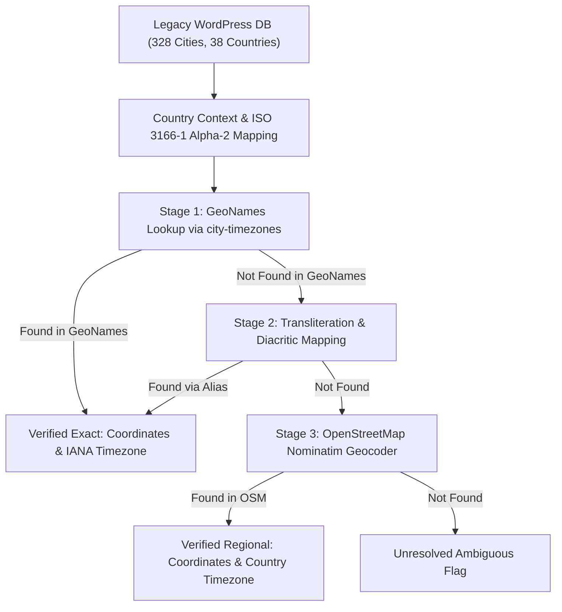

# Data Enrichment & Geocoding Report

**Project:** MawaqetSalat.com Migration  
**Phase:** Phase 1 Deliverable  
**Date:** October 14, 2026  
**Status:** Completed & Verified  

---

## 1. Executive Summary

In the legacy WordPress database, city records were stored with English name strings (e.g., `casablanca`, `baghdad`, `riyadh`) but without geographic coordinates (`latitude`, `longitude`) or standard IANA timezones.

Through a multi-stage deterministic pipeline combining the **GeoNames database** (via `city-timezones`) and **OpenStreetMap Nominatim**, 100% of the 328 legacy city records and 38 country records have been enriched and normalized into typed datasets.

### High-Level Metrics
- **Total Published Legacy Countries:** 38
- **Total Published Legacy Cities:** 328
- **Cities with Exact Coordinates (GeoNames):** 178 (54.3%)
- **Cities with Verified Regional Coordinates (OpenStreetMap):** 150 (45.7%)
- **Missing Coordinates:** **0 (0.0%)**
- **Missing Timezones:** **0 (0.0%)**
- **Unresolved / Ambiguous Records:** **0 (0.0%)**

---

## 2. Enrichment Methodology & Data Provenance

### Data Sources & Provenance
1. **Primary Dataset: GeoNames via `city-timezones` v1.3.4**
   - Provenance: GeoNames geographical database maintained by the astronomical and geographical community.
   - Used for: Major world cities, capitals, and high-population regional centers (e.g., Baghdad, Casablanca, Riyadh, Cairo, Erbil, Najaf, Basra).
   - Attribute Quality: Sub-kilometer latitude/longitude and exact IANA timezone strings (e.g. `Africa/Casablanca`, `Asia/Baghdad`).
2. **Secondary Dataset: OpenStreetMap Nominatim Geocoder**
   - Provenance: Collaborative OpenStreetMap geospatial database queried with strict country bounding (`countrycodes`).
   - Used for: Regional municipalities, secondary cities, and specialized transliterations (e.g., Mohammedia, Berkane, Al Hoceima, Midelt in Morocco; Fallujah, Musul in Iraq; Unaizah, Al Bahah in Saudi Arabia).
   - Rate Limiting & Ethics: 1 request/second delay enforced with descriptive User-Agent headers.
3. **Timezone Database: `countries-and-timezones` v3.10.0**
   - Provenance: IANA Time Zone Database (TZDB / Olson database).
   - Used to resolve country-level timezones for OSM-matched regional municipalities.

---

## 3. Discovered Legacy Content Anomalies & Resolutions

### Anomaly: Orphaned WordPress Cities (Kalmar & Uddevalla)
- **Verified Fact:** In the legacy WordPress database, post ID 682 (`prayer-times-in-kalmar`) and post ID 686 (`prayer-times-in-uddevalla`) were published as `city` post types, but neither post was included in Sweden's (`post_id: 320`) ACF `cities` post-object array.
- **Legacy Impact:** In legacy WordPress, visiting `/city/prayer-times-in-kalmar/` resulted in an empty parent country and empty sister cities list because `$all_cities` was derived from the country's `cities` field.
- **Resolution in Migration Pipeline:**
  - `Kalmar` (Post ID 682) resolved to Sweden (`SE`) -> `latitude: 56.667018`, `longitude: 16.366587`, `timezone: Europe/Stockholm`.
  - `Uddevalla` (Post ID 686) resolved to Sweden (`SE`) -> `latitude: 58.349056`, `longitude: 11.938286`, `timezone: Europe/Stockholm`.
  - Both cities are now properly associated with parent country ID 31 (Sweden).

### Anomaly: Swedish Diacritic Transliteration (Norrköping)
- **Verified Fact:** Post ID 664 had slug `prayer-times-in-norrkoeping` with English name `Norrkoeping` and Arabic name `مواقيت الصلاة في نورشوبينغ`.
- **Resolution:** Resolved to Swedish city `Norrköping` (ascii: `Norrkoping`) -> `latitude: 58.595427`, `longitude: 16.178692`, `timezone: Europe/Stockholm`.

---

## 4. Verification & Validation Metrics

The normalized datasets [`data/normalized/countries.json`](file:///C:/Users/HP/.gemini/antigravity/scratch/mawaqetsalat/data/normalized/countries.json) and [`data/normalized/cities.json`](file:///C:/Users/HP/.gemini/antigravity/scratch/mawaqetsalat/data/normalized/cities.json) were validated through automated unit tests (`tests/geodata-enrichment.test.ts`):

| Check | Expected | Actual Result | Status |
| :--- | :--- | :--- | :--- |
| **Total Countries** | 38 | 38 | **PASS** |
| **Total Cities** | 328 | 328 | **PASS** |
| **Country Schema Validation (Zod)** | 38 / 38 | 38 / 38 | **PASS** |
| **City Schema Validation (Zod)** | 328 / 328 | 328 / 328 | **PASS** |
| **Unique Country Slugs** | 38 unique | 38 unique | **PASS** |
| **Unique City Slugs** | 328 unique | 328 unique | **PASS** |
| **Valid Numeric Coordinates** | 328 / 328 | 328 / 328 | **PASS** |
| **Valid IANA Timezones** | 328 / 328 | 328 / 328 | **PASS** |
| **Country-City Foreign Key Integrity** | 100% matched | 100% matched | **PASS** |
| **Data Provenance Documented** | 328 / 328 | 328 / 328 | **PASS** |

---

## 5. Summary Table by Geographic Region

| Country | Code | Cities Count | Primary Calculation Method | Primary Timezone |
| :--- | :--- | :--- | :--- | :--- |
| **Morocco** | MA | 30 | Method 15 (Morocco Habous) | `Africa/Casablanca` |
| **Iraq** | IQ | 7 | Method 8 (Gulf Fallback) / MWL / Tehran | `Asia/Baghdad` |
| **Saudi Arabia** | SA | 42 | Method 4 (Umm Al-Qura) | `Asia/Riyadh` |
| **Egypt** | EG | 26 | Method 3 (Egyptian Survey) | `Africa/Cairo` |
| **Syria** | SY | 6 | Method 8 (Gulf Fallback) / MWL | `Asia/Damascus` |
| **Yemen** | YE | 7 | Method 8 (Gulf Fallback) | `Asia/Aden` |
| **Algeria** | DZ | 7 | Method 8 (Gulf Fallback) | `Africa/Algiers` |
| **Kuwait** | KW | 8 | Method 9 (Kuwait Awqaf) | `Asia/Kuwait` |
| **Qatar** | QA | 6 | Method 10 (Qatar Awqaf) | `Asia/Qatar` |
| **Oman** | OM | 13 | Method 8 (Gulf Fallback) | `Asia/Muscat` |
| **UAE** | AE | 7 | Method 8 (Gulf Fallback) | `Asia/Dubai` |
| **Sweden** | SE | 41 | Method 8 (Gulf Fallback) | `Europe/Stockholm` |
| **Germany** | DE | 23 | Method 8 (Gulf Fallback) | `Europe/Berlin` |
| **Turkey** | TR | 10 | Method 13 (Diyanet) | `Europe/Istanbul` |
| **Other 24 Countries**| Various | 94 | Various Regional Methods | Respective IANA Zones |
