# Phase 4A — SEO-Driven City Expansion Candidate Audit
**Document:** `docs/PHASE_4A_CITY_EXPANSION_CANDIDATES.md`  
**Project:** `C:\Users\HP\Desktop\mawaqetsalat`  
**Live Site:** `https://mawaqetsalat.com/`  
**Date:** October 20, 2026  
**Status:** Audit & Candidate Formulation Complete (Read-Only — No Code or Data Modified)  

---

## 1. Executive Summary & Baseline State

### 1.1 Verified Baseline Metrics
All metrics were verified through read-only inspection of repository files, data structures, and production endpoints:

| Metric | Measured Value | Verification Source |
|---|---|---|
| **Supported Countries** | **38 countries** | `data/normalized/countries.json` |
| **Published Cities** | **478 cities** | `data/normalized/cities.json` |
| **Sitemap XML URLs** | **521 URLs** (478 cities + 38 countries + 5 static) | `src/app/sitemap.ts` & live `https://mawaqetsalat.com/sitemap.xml` |
| **Next.js SSG Routes** | **528 static pages** (+ 2 dynamic routes) | Verified via `next build` trace |
| **Legacy SEO URLs Preserved** | **372 / 372 URLs (100%)** | `data/migration/legacy-urls.json` & `scripts/validate-urls.js` |
| **Mobile Traffic Share** | **94.6%** | `legacy-data/gsc/Appareils.csv` |
| **GSC Historical Archive** | **9,262 clicks / 6,571,114 impressions** | `legacy-data/gsc/Pays.csv` & `legacy-data/gsc/Requêtes.csv` |
| **Phase 3.6 Coordinates Status** | **100% Resolved & Hardened** | `tests/palestine-coordinates.test.ts` (14/14 test suites passing) |

### 1.2 Inspected Project Files
1. **Audits & Specifications:**
   - `EXPANSION_CONTINUATION_AUDIT.md` (Full repository audit from prior step)
   - `docs/PHASE_3_6_COORDINATE_CORRECTION_REPORT.md` (Palestinian coordinates hardening)
   - `docs/CITY_EXPANSION_AUDIT.md` (Phase 0 expansion architecture rules & thresholds)
   - `docs/PHASE_3_EXPANSION_REPORT.md` (Prior batch execution of 100 cities)
2. **Datasets & Schemas:**
   - `data/normalized/cities.json` (478 active city records)
   - `data/normalized/countries.json` (38 active country records)
   - `src/types/location.ts` (`CitySchema`, `CountrySchema`, `CoordinatesSchema`)
   - `src/lib/data.ts` (Data access layer, method mappings, slug indexing)
   - `data/migration/legacy-urls.json` (372 immutable historical URL destinations)
3. **Search Console Data:**
   - `legacy-data/gsc/Pays.csv` (281 country rows with measured clicks and impressions)
   - `legacy-data/gsc/Pages.csv` (281 historical URL rows with performance metrics)
   - `legacy-data/gsc/Requêtes.csv` (1,000 top query terms with clicks and impressions)
   - `legacy-data/gsc/Appareils.csv` (Device breakdown: Mobile, Desktop, Tablet)
4. **Validation Scripts & Engine:**
   - `scripts/expansion-validation-gate.js` (15-check automated gating suite)
   - `scripts/validate-urls.js` (Legacy URL integrity checker)
   - `src/services/prayer-service.ts` (`adhan` calculation engine)

---

## 2. Search Demand & Geographic Gap Analysis

### 2.1 Measured Geographic Traffic Distribution (GSC Data)
According to `legacy-data/gsc/Pays.csv`, search demand is heavily concentrated in several key Arab and Islamic nations:

```
1. Maroc (Morocco)          : 4,077 clicks | 1,296,751 impressions (35 published cities)
2. Irak (Iraq)              : 2,908 clicks | 2,206,133 impressions (14 published cities)  <-- MAJOR UNDERREPRESENTATION
3. Syrie (Syria)            :   560 clicks |   912,593 impressions (16 published cities)
4. Arabie Saoudite (SA)     :   358 clicks | 1,002,206 impressions (42 published cities)
5. Égypte (Egypt)           :   268 clicks |   543,063 impressions (26 published cities)  <-- MAJOR UNDERREPRESENTATION
6. Yémen (Yemen)            :   230 clicks |    86,250 impressions (13 published cities)
7. Algérie (Algeria)        :   188 clicks |    29,232 impressions (24 published cities)
8. Soudan (Sudan)           :   145 clicks |    92,571 impressions (19 published cities)
...
28. Jordanie (Jordan)       :     5 clicks |     8,422 impressions (8 published cities)
30. Bahreïn (Bahrain)       :     4 clicks |     2,425 impressions (1 published city)
```

### 2.2 Critical Discovery: Jordan & Bahrain Existing Status
A thorough inspection of `data/normalized/cities.json` and `legacy-data/gsc/Pages.csv` yielded critical facts that must prevent candidate misidentification:

1. **Jordan:**
   - **Already Published:** **Irbid (`prayer-times-in-irbid`, ID 107)**, **Madaba (`prayer-times-in-madaba`, ID 108)**, and **Amman (`prayer-times-in-amman_city`, ID 106)** were part of the original legacy migration.
   - **Added in Phase 2:** Zarqa (`zarqa`, ID 343), Aqaba (`aqaba`, ID 344), Salt (`salt`, ID 345), Mafraq (`mafraq`, ID 346), and Karak (`karak`, ID 347).
   - In `legacy-data/gsc/Pages.csv`, `https://mawaqetsalat.com/city/prayer-times-in-irbid/` recorded **3 clicks, 2,084 impressions at average position 12.64**.
   - **Crucial Warning:** Irbid and Madaba are **NOT** expansion candidates; they are already indexed and published. Adding them as new candidates would cause severe slug/URL collisions.
   - Genuine Jordan gaps: Jerash (`جرش`), Ma'an (`معان`), and Tafilah (`الطفيلة`).

2. **Bahrain:**
   - Currently has exactly **1 city**: Manama (`prayer-times-in-manama`, ID 147).
   - Entire country dimensions: ~48 km north-to-south, ~16 km east-to-west. Total area: ~780 km².
   - Distances from Manama:
     - Muharraq (`المحرق`): ~3.7 km
     - Isa Town (`مدينة عيسى`): ~7.0 km
     - Sitra (`سترة`): ~8.5 km
     - Riffa (`الرفاع`): ~12.1 km
     - Hamad Town (`مدينة حمد`): ~16.2 km
   - Astronomical prayer-time difference across Bahrain: **Less than 15–20 seconds**.
   - **Thin Content & SEO Risk:** Creating standalone programmatic pages for localities within 4–12 km of Manama with identical astronomical schedules presents a high risk of "doorway page" flags by Google Search Console without distinct mosque/facility data.

3. **High-Demand Coverage Gaps (Iraq & Egypt):**
   - **Iraq:** 2,206,133 impressions (#1 across all countries in GSC), but only 14 cities in dataset. Major governorate capitals (>300K–600K pop) such as Duhok, Amarah, Samarra, Baqubah, and Samawah are completely missing.
   - **Egypt:** 543,063 impressions (#5 in GSC), but only 26 cities in dataset. El Mansoura (pop >540,000, capital of Dakahlia) and El Mahalla El Kubra (pop >535,000) are absent.

---

## 3. Candidate Evaluation & Ranking

### 3.1 Gating Rules (Phase 0 Specification)
In accordance with `docs/CITY_EXPANSION_AUDIT.md`, all candidates must satisfy:
- **G1 (Slug Safety):** Must not match any existing slug in `cities.json`, `countries.json`, or `legacy-urls.json`.
- **G2 (Spatial Separation):** Geographic distance $\ge 25\text{ km}$ from any existing city within the same country to prevent metropolitan satellite cannibalization.
- **G3 (Population Viability):** Urban population $\ge 40,000$ (with exceptions for isolated governorate capitals).
- **G4 (Data Provenance):** Verified in `city-timezones v1.3.4` (derived from GeoNames / SimpleMaps) or primary national geodetic gazetteers.
- **G5 (Calculation Parity):** Supported IANA timezone and mapped national calculation method.

---

### 3.2 Candidate Evaluation Matrix

| Candidate City | Country & ID | Population | Nearest Existing City & Distance | GSC Evidence Tier | Provenance Source | Status / Verdict |
|---|:---:|:---:|:---:|:---:|---|:---:|
| **المنصورة** (El Mansura) | Egypt (EG / 2) | 540,247 | Kafr el Sheikh (42.8 km) | High (Egypt 543K imp) | `city-timezones v1.3.4` | **APPROVED (Rank 1)** |
| **دهوك** (Duhok / Dahuk) | Iraq (IQ / 15) | 620,500 | Mosul (59.5 km) | High (Iraq 2.2M imp) | `city-timezones v1.3.4` | **APPROVED (Rank 2)** |
| **العمارة** (Al Amarah) | Iraq (IQ / 15) | 334,155 | Nasiriyah (122.1 km) | High (Iraq 2.2M imp) | `city-timezones v1.3.4` | **APPROVED (Rank 3)** |
| **سامراء** (Samarra) | Iraq (IQ / 15) | 158,508 | Fallujah (93.8 km) | High (Iraq 2.2M imp) | `city-timezones v1.3.4` | **APPROVED (Rank 4)** |
| **بعقوبة** (Baqubah) | Iraq (IQ / 15) | 226,015 | Baghdad (51.6 km) | High (Iraq 2.2M imp) | `city-timezones v1.3.4` | **APPROVED (Rank 5)** |
| **المحلة الكبرى** (El Mahalla El Kubra) | Egypt (EG / 2) | 535,278 | Tanta (25.6 km) | High (Egypt 543K imp) | `city-timezones v1.3.4` | **APPROVED (Rank 6)** |
| **جرش** (Jerash) | Jordan (JO / 16) | ~50,745 | Zarqa (29.9 km) | Moderate (Jordan 8.4K imp) | GeoNames ID 248944 | **APPROVED (Rank 7)** |
| **معان** (Ma'an) | Jordan (JO / 16) | 50,350 | Aqaba (97.5 km) | Moderate (Jordan 8.4K imp) | `city-timezones v1.3.4` | **APPROVED (Rank 8)** |
| **السماوة** (As Samawah) | Iraq (IQ / 15) | 163,934 | Diwaniyah (82.7 km) | High (Iraq 2.2M imp) | `city-timezones v1.3.4` | **APPROVED (Rank 9)** |
| **جنين** (Jenin) | Palestine (PS / 12) | ~49,908 | Nablus (26.9 km) | Moderate (Palestine 14.4K imp) | GeoNames ID 282806 | **APPROVED (Rank 10)** |
| **الطفيلة** (At Tafilah) | Jordan (JO / 16) | 25,429 | Karak (40.4 km) | Low (pop < 40K) | `city-timezones v1.3.4` | **Deferred (Batch 2)** |
| **عجلون** (Ajloun) | Jordan (JO / 16) | 17,500 | Jerash (16.2 km) | Low (distance < 25 km) | GeoNames ID 249080 | **Deferred (Proximity)** |
| **الرمثا** (Ar Ramtha) | Jordan (JO / 16) | 164,211 | Irbid (14.7 km) | Moderate | `city-timezones v1.3.4` | **Rejected (Distance 14.7 km)** |
| **الرفاع** (Riffa) | Bahrain (BH / 5) | 121,566 | Manama (12.1 km) | Low (Bahrain 2.4K imp) | GeoNames ID 290299 | **Deferred (Distance 12.1 km)** |
| **المحرق** (Muharraq) | Bahrain (BH / 5) | 176,583 | Manama (3.7 km) | Low (Bahrain 2.4K imp) | GeoNames ID 290320 | **Deferred (Distance 3.7 km)** |
| **بيت لحم** (Bethlehem) | Palestine (PS / 12) | 28,591 | Jerusalem (8.4 km) | Moderate | GeoNames ID 284315 | **Deferred (Distance 8.4 km)** |
| **أريحا** (Jericho) | Palestine (PS / 12) | 24,700 | Jerusalem (23.5 km) | Low (pop < 40K) | GeoNames ID 284305 | **Deferred (Batch 2)** |
| **خان يونس** (Khan Yunis) | Palestine (PS / 12) | 205,125 | Gaza City (24.3 km) | Moderate | GeoNames ID 281133 | **Deferred (Proximity)** |
| **صور** (Tyre / Sour) | Lebanon (LB / 14) | 135,204 | Nabatieh (26.8 km) | Moderate (Lebanon 6.5K imp) | GeoNames ID 266027 | **Deferred (Name collision)** |
| **بعلبك** (Baalbeck) | Lebanon (LB / 14) | 82,600 | Already published | High | Existing ID 117 | **REJECTED (Already exists)** |
| **إربد** (Irbid) | Jordan (JO / 16) | 471,020 | Already published | High (2,084 GSC imp) | Existing ID 107 | **REJECTED (Already exists)** |
| **مأدبا** (Madaba) | Jordan (JO / 16) | 110,000 | Already published | Moderate | Existing ID 108 | **REJECTED (Already exists)** |

---

## 4. Detailed Dossier: Recommended First Batch (Top 10 Cities)

The recommended batch strictly adheres to the $\le 10$ city budget, delivers maximum user value, eliminates duplicate risks, and focuses on high-impression geographic voids in Iraq, Egypt, Jordan, and Palestine:

```mermaid
flowchart TD
    subgraph Batch["Recommended Batch (10 Cities)"]
        direction TB
        IQ1["1. دهوك (Duhok) - IQ | Pop: 620K"]
        IQ2["2. العمارة (Amarah) - IQ | Pop: 334K"]
        IQ3["3. سامراء (Samarra) - IQ | Pop: 158K"]
        IQ4["4. بعقوبة (Baqubah) - IQ | Pop: 226K"]
        IQ5["5. السماوة (Samawah) - IQ | Pop: 164K"]
        EG1["6. المنصورة (Mansoura) - EG | Pop: 540K"]
        EG2["7. المحلة الكبرى (El Mahalla) - EG | Pop: 535K"]
        JO1["8. جرش (Jerash) - JO | Pop: 51K"]
        JO2["9. معان (Ma'an) - JO | Pop: 50K"]
        PS1["10. جنين (Jenin) - PS | Pop: 50K"]
    end
```



### City 1: المنصورة (Mansoura) — Egypt
- **Country:** Egypt (`countryCode: EG`, `countryId: 2`)
- **Proposed Slug:** `prayer-times-in-mansoura`
- **Canonical URL:** `/city/prayer-times-in-mansoura/`
- **Arabic Name:** المنصورة
- **English Name:** mansoura
- **Population:** 540,247 (Major Delta hub)
- **Coordinates:** Latitude: `31.05044191`, Longitude: `31.38003780`
- **Coordinates Source:** `city-timezones v1.3.4` (Record `El Mansura`)
- **Timezone:** `Africa/Cairo`
- **Calculation Method:** `EGYPT` (Egyptian General Authority of Survey, Method ID 3)
- **Spatial Isolation:** 42.8 km from Kafr El Sheikh, 50.2 km from Tanta
- **SEO & Search Rationale:** Capital of Dakahlia Governorate. Egypt generated 543,063 impressions in GSC. Complete void in current directory.
- **Confidence:** **HIGH (Tier 1)**

### City 2: دهوك (Duhok) — Iraq
- **Country:** Iraq (`countryCode: IQ`, `countryId: 15`)
- **Proposed Slug:** `prayer-times-in-duhok`
- **Canonical URL:** `/city/prayer-times-in-duhok/`
- **Arabic Name:** دهوك
- **English Name:** duhok
- **Population:** 620,500
- **Coordinates:** Latitude: `36.86670013`, Longitude: `43.00000263`
- **Coordinates Source:** `city-timezones v1.3.4` (Record `Dahuk`)
- **Timezone:** `Asia/Baghdad`
- **Calculation Method:** `GULF` (Method ID 8, default for Iraq)
- **Spatial Isolation:** 59.5 km from Mosul, 150 km from Erbil
- **SEO & Search Rationale:** Capital of Duhok Governorate (Kurdistan). Iraq drives 2.2M impressions. Essential geographical completion of northern Iraq.
- **Confidence:** **HIGH (Tier 1)**

### City 3: العمارة (Amarah) — Iraq
- **Country:** Iraq (`countryCode: IQ`, `countryId: 15`)
- **Proposed Slug:** `prayer-times-in-amarah`
- **Canonical URL:** `/city/prayer-times-in-amarah/`
- **Arabic Name:** العمارة
- **English Name:** amarah
- **Population:** 334,155
- **Coordinates:** Latitude: `31.84160809`, Longitude: `47.15116817`
- **Coordinates Source:** `city-timezones v1.3.4` (Record `Al Amarah`)
- **Timezone:** `Asia/Baghdad`
- **Calculation Method:** `GULF` (Method ID 8)
- **Spatial Isolation:** 122.1 km from Nasiriyah, 160 km from Basra, 120 km from Kut
- **SEO & Search Rationale:** Capital of Maysan Governorate on the Tigris. Major southern Iraq administrative hub.
- **Confidence:** **HIGH (Tier 1)**

### City 4: سامراء (Samarra) — Iraq
- **Country:** Iraq (`countryCode: IQ`, `countryId: 15`)
- **Proposed Slug:** `prayer-times-in-samarra`
- **Canonical URL:** `/city/prayer-times-in-samarra/`
- **Arabic Name:** سامراء
- **English Name:** samarra
- **Population:** 158,508
- **Coordinates:** Latitude: `34.19399705`, Longitude: `43.87500062`
- **Coordinates Source:** `city-timezones v1.3.4` (Record `Samarra`)
- **Timezone:** `Asia/Baghdad`
- **Calculation Method:** `GULF` (Method ID 8)
- **Spatial Isolation:** 93.8 km from Fallujah, 118 km from Baghdad
- **SEO & Search Rationale:** Major historical Islamic capital and UNESCO World Heritage center in Saladin Governorate. Significant prayer-time query volume.
- **Confidence:** **HIGH (Tier 1)**

### City 5: بعقوبة (Baqubah) — Iraq
- **Country:** Iraq (`countryCode: IQ`, `countryId: 15`)
- **Proposed Slug:** `prayer-times-in-baqubah`
- **Canonical URL:** `/city/prayer-times-in-baqubah/`
- **Arabic Name:** بعقوبة
- **English Name:** baqubah
- **Population:** 226,015
- **Coordinates:** Latitude: `33.74764162`, Longitude: `44.65726355`
- **Coordinates Source:** `city-timezones v1.3.4` (Record `Baqubah`)
- **Timezone:** `Asia/Baghdad`
- **Calculation Method:** `GULF` (Method ID 8)
- **Spatial Isolation:** 51.6 km northeast of Baghdad
- **SEO & Search Rationale:** Capital of Diyala Governorate. Completes eastern-central Iraq coverage.
- **Confidence:** **HIGH (Tier 1)**

### City 6: المحلة الكبرى (El Mahalla El Kubra) — Egypt
- **Country:** Egypt (`countryCode: EG`, `countryId: 2`)
- **Proposed Slug:** `prayer-times-in-el-mahalla-el-kubra`
- **Canonical URL:** `/city/prayer-times-in-el-mahalla-el-kubra/`
- **Arabic Name:** المحلة الكبرى
- **English Name:** el mahalla el kubra
- **Population:** 535,278
- **Coordinates:** Latitude: `30.97056`, Longitude: `31.16694`
- **Coordinates Source:** GeoNames (ID 360526)
- **Timezone:** `Africa/Cairo`
- **Calculation Method:** `EGYPT` (Method ID 3)
- **Spatial Isolation:** 25.6 km from Tanta (satisfies $\ge 25\text{ km}$ threshold)
- **SEO & Search Rationale:** Largest city in Gharbia Governorate; massive industrial and urban center with distinct civic identity.
- **Confidence:** **HIGH (Tier 1)**

### City 7: جرش (Jerash) — Jordan
- **Country:** Jordan (`countryCode: JO`, `countryId: 16`)
- **Proposed Slug:** `prayer-times-in-jerash`
- **Canonical URL:** `/city/prayer-times-in-jerash/`
- **Arabic Name:** جرش
- **English Name:** jerash
- **Population:** ~50,745 (governorate > 237,000)
- **Coordinates:** Latitude: `32.2723`, Longitude: `35.8914`
- **Coordinates Source:** GeoNames (ID 248944) / Hashemite Geodetic Survey
- **Timezone:** `Asia/Amman`
- **Calculation Method:** `GULF` (Method ID 8)
- **Spatial Isolation:** 29.9 km from Zarqa, 35.1 km from Irbid, 40 km from Amman
- **SEO & Search Rationale:** Capital of Jerash Governorate. Directly fills the Jordan geographic gap highlighted in the evaluation criteria.
- **Confidence:** **HIGH (Tier 1)**

### City 8: معان (Ma'an) — Jordan
- **Country:** Jordan (`countryCode: JO`, `countryId: 16`)
- **Proposed Slug:** `prayer-times-in-maan`
- **Canonical URL:** `/city/prayer-times-in-maan/`
- **Arabic Name:** معان
- **English Name:** maan
- **Population:** 50,350
- **Coordinates:** Latitude: `30.19200312`, Longitude: `35.73600358`
- **Coordinates Source:** `city-timezones v1.3.4` (Record `Ma'an`)
- **Timezone:** `Asia/Amman`
- **Calculation Method:** `GULF` (Method ID 8)
- **Spatial Isolation:** 97.5 km from Aqaba, 130 km from Karak
- **SEO & Search Rationale:** Capital of Ma'an Governorate (largest governorate in Jordan). Crucial southern desert transport and pilgrimage crossroads.
- **Confidence:** **HIGH (Tier 1)**

### City 9: السماوة (As Samawah) — Iraq
- **Country:** Iraq (`countryCode: IQ`, `countryId: 15`)
- **Proposed Slug:** `prayer-times-in-samawah`
- **Canonical URL:** `/city/prayer-times-in-samawah/`
- **Arabic Name:** السماوة
- **English Name:** samawah
- **Population:** 163,934
- **Coordinates:** Latitude: `31.30985760`, Longitude: `45.28027462`
- **Coordinates Source:** `city-timezones v1.3.4` (Record `As Samawah`)
- **Timezone:** `Asia/Baghdad`
- **Calculation Method:** `GULF` (Method ID 8)
- **Spatial Isolation:** 82.7 km from Diwaniyah, 105 km from Nasiriyah
- **SEO & Search Rationale:** Capital of Al-Muthanna Governorate on the Euphrates.
- **Confidence:** **HIGH (Tier 1)**

### City 10: جنين (Jenin) — Palestine
- **Country:** Palestine (`countryCode: PS`, `countryId: 12`)
- **Proposed Slug:** `prayer-times-in-jenin`
- **Canonical URL:** `/city/prayer-times-in-jenin/`
- **Arabic Name:** جنين
- **English Name:** jenin
- **Population:** ~49,908 (governorate > 330,000)
- **Coordinates:** Latitude: `32.4606`, Longitude: `35.2974`
- **Coordinates Source:** GeoNames (ID 282806)
- **Timezone:** `Asia/Gaza`
- **Calculation Method:** `GULF` (Method ID 8)
- **Spatial Isolation:** 26.9 km from Nablus (satisfies $\ge 25\text{ km}$ threshold)
- **SEO & Search Rationale:** Capital of Jenin Governorate. Completes northern West Bank coverage cleanly without proximity collisions.
- **Confidence:** **HIGH (Tier 1)**

---

## 5. Potential URL Conflicts, Ambiguities & Collision Risks

1. **Baalbek Collision:**
   - Suffix `baalbek` conflicts with legacy record `prayer-times-in-baalbeck` (ID 117).
   - **Mitigation:** Rejected completely from expansion.
2. **Irbid and Madaba Collisions:**
   - Existing records `prayer-times-in-irbid` (ID 107) and `prayer-times-in-madaba` (ID 108).
   - **Mitigation:** Confirmed already live; excluded from expansion batch.
3. **Arabic Name Ambiguity for Tyre (صور):**
   - Candidate `prayer-times-in-tyre` (Lebanon) shares the exact Arabic spelling `صور` with existing record `prayer-times-in-sur` (ID 164, Sur, Oman).
   - **Mitigation:** Deferred to avoid ambiguous search autocomplete dropdown results until multi-country disambiguation labels are rendered in `CitySearch.tsx`.
4. **Bahrain Hyper-Local Cannibalization:**
   - Localities in Bahrain (Muharraq, Riffa) are 3.7 km to 12.1 km from Manama, producing < 20 seconds astronomical variance.
   - **Mitigation:** Deferred to protect domain quality against thin/doorway page penalties.
5. **Slug Verification:**
   - All 10 recommended slugs were verified against `cities.json`, `countries.json`, and `legacy-urls.json`: **0 collisions detected**.

---

## 6. Pre-Implementation Validation Requirements

Prior to merging any candidate batch in a future execution phase, the following gating protocol must be strictly adhered to:

1. **Staging File Generation:**
   - Candidate records must be formatted in a dedicated staging file: `data/staging/city-expansion-phase4a-10.json`.
   - Rejections must be documented in: `data/staging/city-expansion-phase4a-rejections.json`.
2. **Negative Gate Verification:**
   - Run candidate proximity tests enforcing $\ge 25\text{ km}$ minimum separation from any sibling city in the same country.
3. **Dataset Integrity Gates:**
   - Run `npm run validate:expansion` — all 15 checks must pass.
   - Run `npm run validate:urls` — all 372 legacy URLs must remain 100% intact.
4. **Astronomical Solvability Smoke Tests:**
   - Run seasonal prayer calculations across all 4 astronomical milestones (Equinoxes and Solstices) ensuring zero `NaN` values and strictly chronological prayer sequences.
5. **Country `totalCities` Synchronization:**
   - `countries.json` `totalCities` counters must be incremented by the exact count added per country:
     - Iraq (ID 15): $14 \to 19$ (+5)
     - Egypt (ID 2): $26 \to 28$ (+2)
     - Jordan (ID 16): $8 \to 10$ (+2)
     - Palestine (ID 12): $9 \to 10$ (+1)
   - New global city total: **488 cities**. New sitemap total: **531 URLs**.
6. **Zero Drift Verification:**
   - Existing city IDs 1–478 and existing country records must remain bit-for-bit immutable against SHA256 checksum snapshots.
7. **Production Build Gate:**
   - `npx tsc --noEmit` (Exit 0)
   - `npm run lint` (Exit 0)
   - `npm run build` (Must generate exactly 538 static pages without warnings)

---

## 7. Explicit Uncertainties & Missing Data

1. **Search Console Access Limitation:**
   - The analysis relies on static repository exports from `legacy-data/gsc/` (captured October 2026). Live, real-time Google Search Console performance data since migration cutover is not directly queryable in this offline environment.
2. **Jordanian Local Awqaf Adjustments:**
   - Jordan historically uses Gulf Method 8 (19.5° Fajr, 90-min Isha). In practice, the Jordanian Ministry of Awqaf publishes fixed calendar tables with minor seasonal solar depression adjustments (e.g., 18° Fajr). Local user overrides via `PrayerControls.tsx` allow users to select MWL (18°/17°), but city records remain on Method 8 to preserve legacy parity.
3. **Bahrain User Search Behavior:**
   - The Search Console export recorded 2,425 impressions for Bahrain at country level, but zero query rows specifically mentioning "المحرق" or "الرفاع" appeared in the top 1,000 queries. Live GSC query data could reveal whether Bahraini users actually search by governorate or simply search for "مواقيت الصلاة في البحرين" / "المنامة".

---

*Phase 4A Audit Complete. No project code or data files were modified.*  
*Next Step: Await user approval of the recommended 10-city batch before initiating staging and implementation.*
